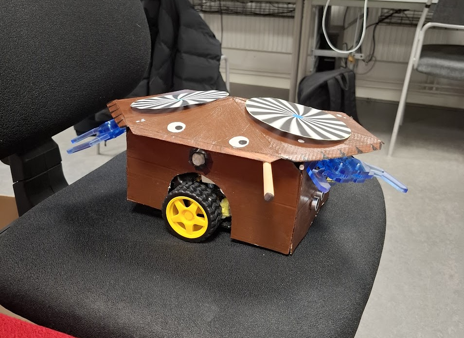
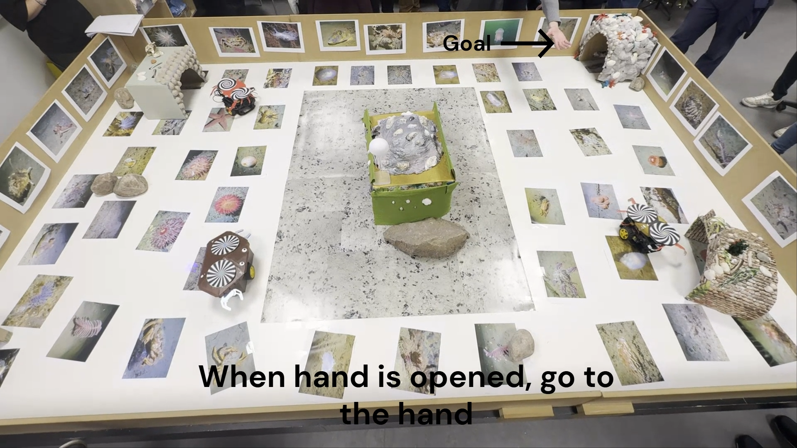
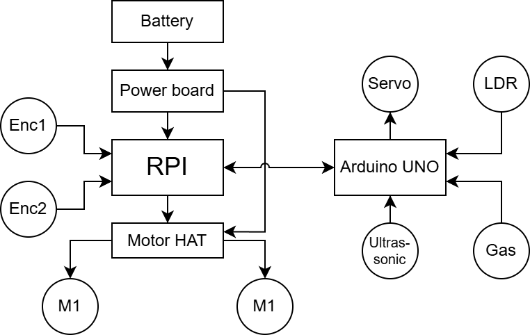

# Design of Embedded and Intelligent Systems – Final Project

An autonomous crab-inspired robot developed as part of the Design of Embedded and Intelligent Systems course.

The robot combines computer vision, sensor integration, and autonomous navigation to respond to its environment.

## Robot

## Demo

[▶ Watch on YouTube](https://www.youtube.com/watch?v=xnOrZGNHbe0)

## Features

- **Autonomous Navigation:** A* pathfinding for navigating around obstacles.
- **Hand Gesture Recognition:** Uses MediaPipe to recognize open palms and fists.
- **Odometry:** Tracks robot movement using wheel encoders.
- **Sensor Integration:** Uses Arduino-connected distance, gas, and light sensors.
- **Reactive Behavior:** Responds to detected food and threats by navigating toward targets or returning home.

## System Overview

## Technologies

- Python
- Raspberry Pi
- Arduino
- ROS 2
- OpenCV & MediaPipe
- A* Pathfinding
- Wheel Encoders & Odometry
